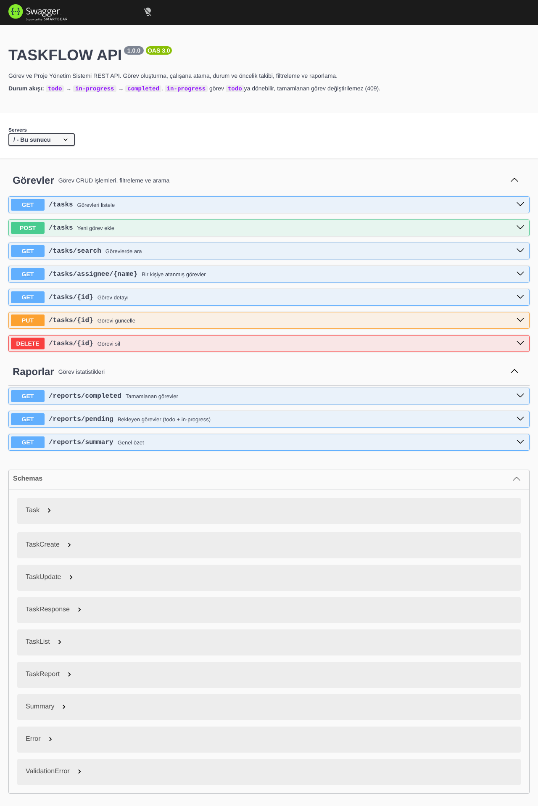
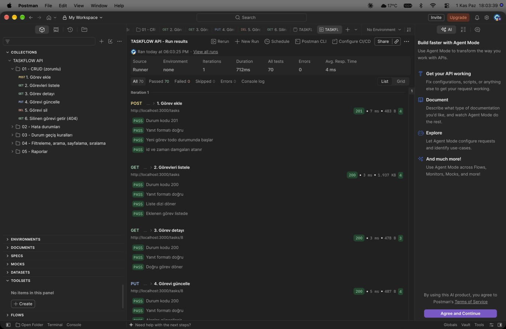

# TASKFLOW API

Görev ve Proje Yönetim Sistemi için Node.js ve Express.js ile geliştirilmiş bir REST API. Bir yazılım ekibindeki görevlerin oluşturulmasını, çalışanlara atanmasını, durum ve öncelik takibini, filtrelenmesini ve raporlanmasını sağlar.

> 19. Dönem Yazılım Mesleki Gelişim Programı, Backend Geliştirme projesi. Hazırlayan: Efe Uğur.

## Özellikler

**Zorunlu kapsam**
- Görev CRUD: ekleme, listeleme, detay, güncelleme, silme
- Express Router ile katmanlı routing (routes, controllers, services)
- Logger middleware: her isteğin zaman damgası, method ve endpoint bilgisi
- Postman ile tüm CRUD uç noktalarının testi

**İsteğe bağlı bölümler (yönergedeki ileri seviye pratikler, tamamı yapıldı)**
- Filtreleme, arama, kişiye göre listeleme, sayfalama ve sıralama
- Validation middleware (title, description, priority, assignee; hatada 400)
- Raporlama servisleri (`/reports/completed`, `/reports/pending`, `/reports/summary`)
- Kapsamlı dokümantasyon: [API dokümanı](docs/API_Dokumantasyonu.md), [test senaryoları](docs/Test_Senaryolari.md), [kullanım kılavuzu](docs/Kullanim_Kilavuzu.md)

**Ek olarak eklenenler**
- Durum geçiş kuralları: görev `todo → in-progress → completed` sırasıyla ilerler, tamamlanan görev kilitlenir (409 Conflict)
- JSON dosyasında kalıcı veri (sunucu yeniden başlasa da görevler korunur, silinen id tekrar kullanılmaz)
- Logger'a durum kodu, yanıt süresi ve dosyaya kayıt (`logs/requests.log`)
- Tutarlı yanıt formatı ve merkezi hata yönetimi (bozuk JSON, geçersiz id, tanımsız rota dahil)
- Otomatik testler: Postman koleksiyonunda 25 istek ve 70 kontrol, kodda 13 test (`npm test`)
- Docker ile tek komutla çalıştırma
- Swagger UI: tarayıcıda canlı API dokümanı ve deneme ekranı (`/api-docs`)

## Kullanılan teknolojiler

Node.js (18 veya üzeri), Express.js 4, dotenv, Swagger UI (swagger-ui-express), Postman, Docker. Testler Node.js'in yerleşik test çalıştırıcısıyla yazıldı, ek test paketi yok.

## Kurulum ve çalıştırma

### 1. Projeyi indirin

```bash
git clone https://github.com/Efeeugur/taskflow-api.git
cd taskflow-api
```

### 2. Bağımlılıkları kurun

```bash
npm install
```

### 3. Ortam değişkenlerini hazırlayın

```bash
cp .env.example .env
```

| Değişken | Varsayılan | Açıklama |
|---|---|---|
| `PORT` | `3000` | Sunucunun dinlediği port |
| `DATA_FILE` | `src/data/tasks.json` | Görevlerin saklandığı dosya |
| `LOG_FILE` | `logs/requests.log` | İstek kayıtlarının yazıldığı dosya |

### 4. (İsteğe bağlı) Örnek veriyi yükleyin

```bash
npm run seed
```

6 örnek görev yükler. Mevcut görevlerin üzerine yazar.

### 5. Sunucuyu başlatın

```bash
npm start
```

Sunucu `http://localhost:3000` adresinde çalışır. Bu adres tarayıcıda açılınca API dokümanı ve deneme ekranına (`/api-docs`) yönlendirir. Geliştirme sırasında dosya değiştikçe yeniden başlaması için `npm run dev` kullanılabilir.

### Docker ile çalıştırma

```bash
docker compose up --build
```

Görevler ve loglar Docker volume'larında saklanır, konteyner silinse de korunur.

## Uç noktalar

| Method | Endpoint | Açıklama |
|---|---|---|
| GET | `/tasks` | Görevleri listeler (`status`, `priority`, `assignee`, `sort`, `page`, `limit` parametreleriyle) |
| GET | `/tasks/:id` | Görev detayı |
| POST | `/tasks` | Yeni görev ekler |
| PUT | `/tasks/:id` | Görevi günceller |
| DELETE | `/tasks/:id` | Görevi siler |
| GET | `/tasks/search?keyword=` | Başlık ve açıklamada arama |
| GET | `/tasks/assignee/:name` | Bir kişiye atanmış görevler |
| GET | `/reports/completed` | Tamamlanan görevler |
| GET | `/reports/pending` | Bekleyen görevler |
| GET | `/reports/summary` | Genel özet |

İstek ve yanıt örnekleri: [docs/API_Dokumantasyonu.md](docs/API_Dokumantasyonu.md). Sunucu çalışırken tüm uç noktalar `http://localhost:3000/api-docs` adresinde Swagger arayüzünden de denenebilir.



## Testler

### Postman

1. Postman'de **Import** ile `postman/Taskflow.postman_collection.json` dosyasını açın.
2. Sunucu çalışırken koleksiyona sağ tıklayıp **Run collection** seçin.
3. 25 istek sırayla çalışır, her isteğin **Tests** sekmesindeki kontroller otomatik doğrulanır.

### Kod testleri

```bash
npm test
```

13 test çalışır. Testler geçici bir veri dosyası kullanır, gerçek görevler etkilenmez.

## Ekran görüntüleri

Postman ile alınan test ekran görüntüleri (koleksiyonun tamamı: 25 istek, 70 kontrol, 0 hata):

| Test | Ekran görüntüsü |
|---|---|
| Görev ekleme (201) | [postman_01_gorev_ekle.png](docs/screenshots/postman_01_gorev_ekle.png) |
| Görevleri listeleme (200) | [postman_02_gorevleri_listele.png](docs/screenshots/postman_02_gorevleri_listele.png) |
| Görev detayı (200) | [postman_03_gorev_detayi.png](docs/screenshots/postman_03_gorev_detayi.png) |
| Görev güncelleme (200) | [postman_04_gorevi_guncelle.png](docs/screenshots/postman_04_gorevi_guncelle.png) |
| Görev silme (200) | [postman_05_gorevi_sil.png](docs/screenshots/postman_05_gorevi_sil.png) |
| Silinen görevi getirme (404) | [postman_06_silinen_gorev_404.png](docs/screenshots/postman_06_silinen_gorev_404.png) |
| Collection Runner: 70/70 test geçti | [postman_07_collection_runner_70_test.png](docs/screenshots/postman_07_collection_runner_70_test.png) |
| Collection Runner: 25 isteğin özeti | [postman_08_collection_runner_ozet.png](docs/screenshots/postman_08_collection_runner_ozet.png) |



## Proje yapısı

```
taskflow-api/
├── src/
│   ├── app.js                    # Express uygulaması ve middleware sırası
│   ├── server.js                 # Sunucuyu başlatır
│   ├── routes/                   # taskRoutes, reportRoutes
│   ├── controllers/              # İstek ve yanıt mantığı
│   ├── services/taskStore.js     # JSON dosyası okuma/yazma
│   ├── middleware/               # logger, validateTask, notFound, errorHandler
│   ├── docs/openapi.js           # Swagger (OpenAPI 3) tanımı
│   ├── utils/                    # Sabitler, sorgu yardımcıları, hata sınıfı
│   └── data/tasks.json           # Görev verisi
├── tests/api.test.js             # Otomatik testler
├── scripts/seed.js               # Örnek veri
├── postman/                      # Postman koleksiyonu
├── docs/                         # Proje dokümanları ve ekran görüntüleri
├── logs/                         # İstek kayıtları
├── Dockerfile
└── docker-compose.yml
```

## Dokümanlar

- [Proje tanıtım dokümanı](docs/Proje_Tanitim_Dokumani.md)
- [API dokümantasyonu](docs/API_Dokumantasyonu.md)
- [Test senaryoları](docs/Test_Senaryolari.md)
- [Kullanım kılavuzu](docs/Kullanim_Kilavuzu.md)
